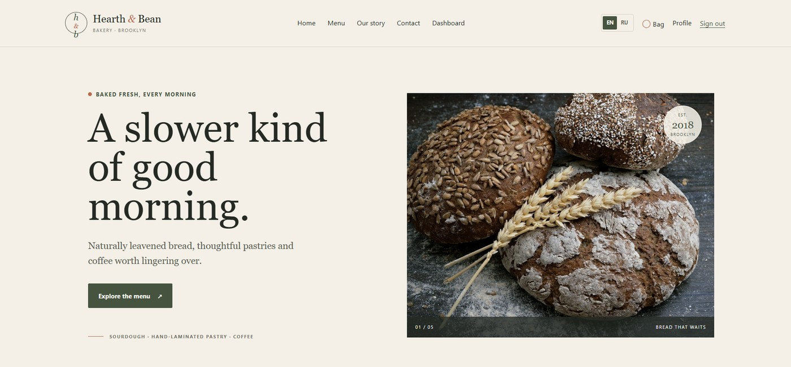
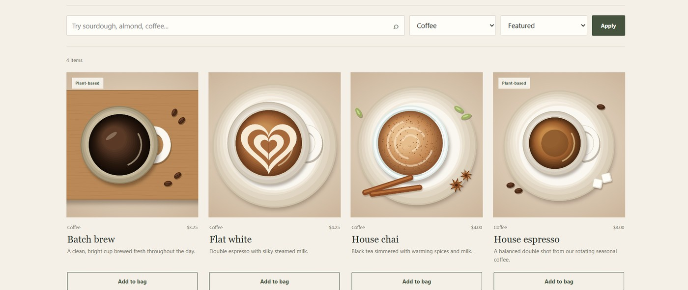
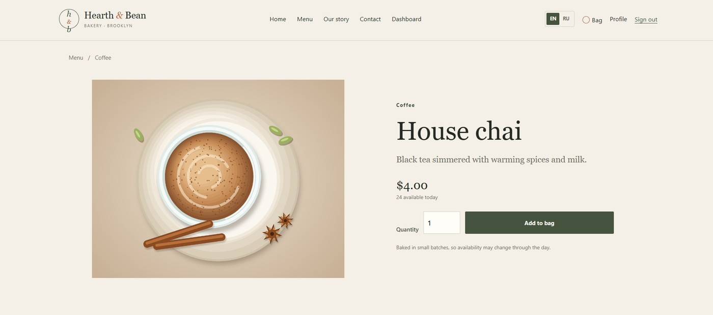
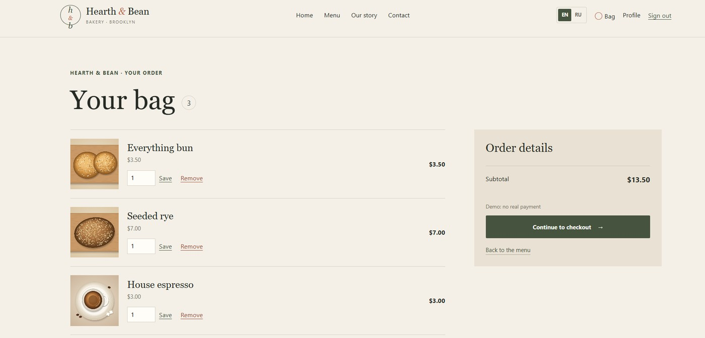
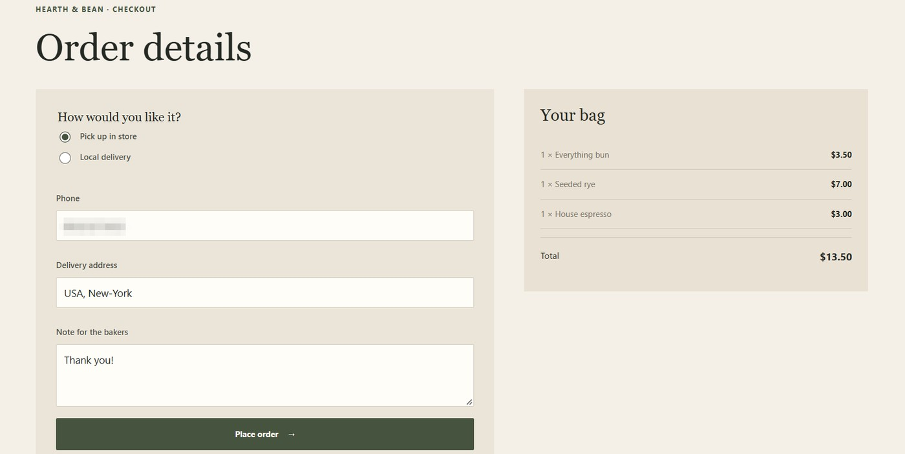
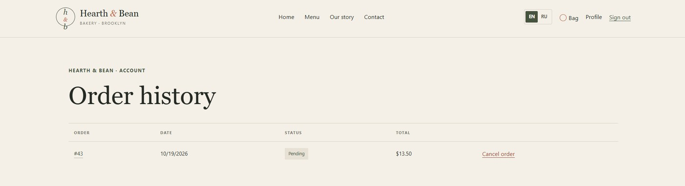
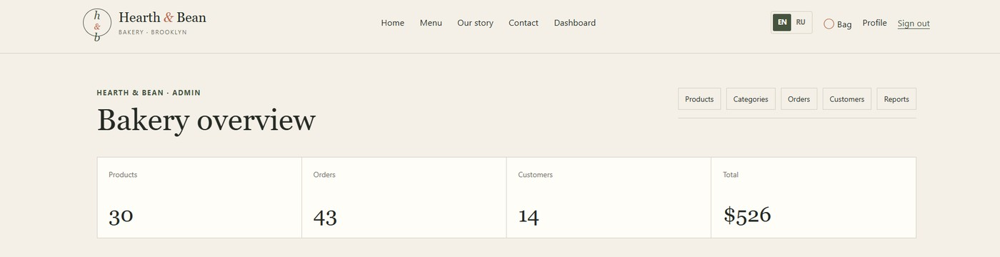
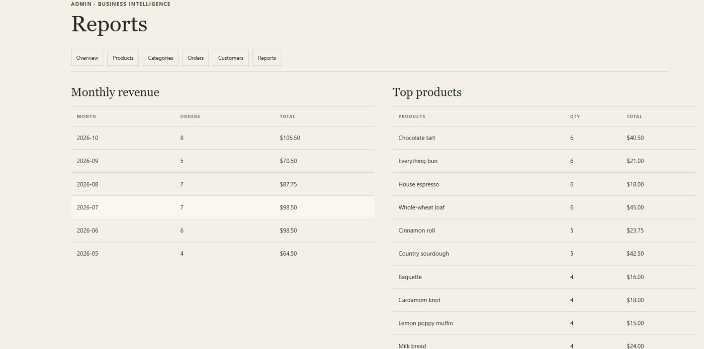

# Hearth & Bean

Двуязычный учебный интернет-магазин вымышленной пекарни на ASP.NET Core MVC, .NET 10, EF Core и SQL Server. По умолчанию интерфейс английский; переключатель EN / RU находится в шапке сайта и сохраняет выбор. Все клиенты и заказы вымышленные, реальной оплаты нет.

## Возможности

- Адаптивная главная, каталог с поиском, фильтрами по категории, сортировкой и постраничным выводом, страницы товаров.
- Гостевая корзина хранится в сессии; корзина покупателя — в SQL Server и объединяется после входа.
- Регистрация, вход и выход через ASP.NET Core Identity, роли Customer и Admin.
- Оформление проверяет телефон, адрес доставки и остатки. Цена берётся из базы, а не из формы.
- История заказов доступна только владельцу. Покупатель может отменить свой заказ Pending; при допустимой отмене остатки возвращаются.
- Админ-панель: показатели, создание и редактирование товаров, скрытие товаров и категорий, статусы заказов, список клиентов и три отчёта.
- Переключение English / Русский сохраняется в cookie культуры.
- Изображения хранятся локально; есть видимый клавиатурный фокус и адаптивная вёрстка (точки перелома 1050, 767 и 380 px).

## Технологии

- .NET 10 SDK, ASP.NET Core MVC, Razor
- Entity Framework Core 10, ASP.NET Core Identity
- SQL Server Express / Developer / LocalDB
- xUnit

## Локальный запуск

Нужны .NET 10 SDK и SQL Server. Строка подключения в репозитории направлена на экземпляр `SQLEXPRESS01`; при необходимости измените `ConnectionStrings:DefaultConnection` в `src/HearthBean.Web/appsettings.json`.

```powershell
dotnet tool restore
dotnet restore HearthBean.slnx
dotnet user-secrets set "DemoAccounts:CustomerPassword" "BakerDemo2026!" --project src/HearthBean.Web
dotnet user-secrets set "DemoAccounts:AdminEmail" "admin@example.com" --project src/HearthBean.Web
dotnet user-secrets set "DemoAccounts:AdminPassword" "HearthAdmin2026!" --project src/HearthBean.Web
dotnet tool run dotnet-ef database update --project src/HearthBean.Web
dotnet run --project src/HearthBean.Web
```

Откройте HTTPS-адрес, напечатанный командой `dotnet run`. При первом запуске приложения идемпотентный `DataSeeder` добавит пять категорий, 30 товаров, 12 покупателей и 40 демонстрационных заказов, затем применит SQL-объекты. Демо-пароли не хранятся ни в коде, ни в конфигурационных файлах репозитория: вы задаёте их сами через `dotnet user-secrets` (команды выше).

Демо-аккаунты (только для демонстрации): `admin@example.com` / `HearthAdmin2026!`; `customer01@example.com` / `BakerDemo2026!`. Это примеры для локальной портфолио-базы; не используйте эти пароли в других системах.

## База данных

EF-модель настроена в `src/HearthBean.Web/Data/AppDbContext.cs`, начальная миграция — в `src/HearthBean.Web/Data/Migrations`, скрипт миграций — `database/schema.sql`. `database/objects.sql` содержит `vw_OrderSummary`, `vw_TopProducts`, `sp_PlaceOrder` и `sp_MonthlyRevenue`. Процедура `sp_PlaceOrder` блокирует строки корзины и товаров, проверяет остатки, сохраняет снимок цен, создаёт заказ и позиции, уменьшает остаток, очищает корзину и при ошибке откатывает транзакцию через `THROW`.

Таблицы нормализованы до 3НФ: Identity-пользователи, категории, товары, корзина, заказы и позиции заказа. `OrderItems.UnitPrice` намеренно дублирует текущую цену товара: это снимок цены на момент покупки, чтобы изменение каталога не меняло историю заказов. В EF настроены уникальные slug, уникальная пара `(UserId, ProductId)` корзины, проверки цены/количества/остатка и индексы по категории товара и `(UserId, OrderDate)` заказа.

ER-диаграмма: [`database/er-diagram.png`](database/er-diagram.png), редактируемый исходник Mermaid: [`database/er-diagram.mmd`](database/er-diagram.mmd). Десять запросов с комментариями, `JOIN`, `GROUP BY`, `HAVING`, подзапросами и оконными функциями: [`database/queries.sql`](database/queries.sql). `database/seed.sql` показывает идемпотентное заполнение категорий; полный каталог и Identity-аккаунты создаются C#-сидером.

## Тесты

Запуск: `dotnet test HearthBean.slnx`.

- **Модульные тесты** (`DomainRulesTests`, 6 методов / 13 случаев, база не нужна): лимиты количества в корзине, расчёт суммы заказа, возврат остатков при отмене, допустимые переходы статусов и правило «покупатель отменяет только свой заказ в статусе Pending».
- **Интеграционные тесты** (`StoredProcedureTests`, 3 теста) выполняют `dbo.sp_PlaceOrder` на настоящем SQL Server: успешный заказ создаёт заказ и позиции, фиксирует цены, списывает остаток и очищает корзину; при нехватке товара вся транзакция откатывается; пустая корзина отклоняется. Каждый тест создаёт и удаляет собственную временную базу из миграций EF и `database/objects.sql`. Они необязательные и помечаются как *пропущенные*, пока не задана строка подключения (логин должен иметь право создавать и удалять базы):

```powershell
$env:HEARTHBEAN_TEST_SQL = "Server=.\SQLEXPRESS01;Trusted_Connection=True;TrustServerCertificate=True"
dotnet test HearthBean.slnx
```

Принадлежность заказов и права администратора проверяются в контроллерах и запросах, автотестами это пока не покрыто.

## Скриншоты

Скриншоты сняты в версии для компьютера на демо-данных.

| | |
| --- | --- |
| <a href="docs/screenshots/01-home.jpg"></a><br>**Главная**: баннер, навигация, переключатель EN / RU | <a href="docs/screenshots/02-menu.jpg"></a><br>**Каталог**: поиск, фильтр по категории, сортировка, карточки |
| <a href="docs/screenshots/03-product.jpg"></a><br>**Товар**: описание, остаток, количество | <a href="docs/screenshots/04-cart.jpg"></a><br>**Корзина**: позиции, количество, сумма |
| <a href="docs/screenshots/05-checkout.jpg"></a><br>**Оформление**: самовывоз или доставка, проверка полей, пометка о демо | <a href="docs/screenshots/06-order-history.jpg"></a><br>**История заказов**: свои заказы, отмена заказа Pending |
| <a href="docs/screenshots/07-admin-overview.jpg"></a><br>**Обзор админа**: основные показатели магазина | <a href="docs/screenshots/08-admin-reports.jpg"></a><br>**Отчёты админа**: выручка по месяцам и топ товаров |

## Безопасность и ограничения

- Хеширование паролей и роли обеспечивает ASP.NET Core Identity. Админ-маршруты защищены ролью Admin, POST-формы — anti-forgery токеном, а глобальный фильтр `AutoValidateAntiforgeryToken` страхует новые действия.
- Заказы выбираются с фильтром по `UserId` текущего пользователя; идентификатор в URL не считается доказательством прав.
- EF-запросы параметризованы. Хранимая процедура вызывается через ADO.NET (`DbCommand` с явными типизированными параметрами), без склейки строк.
- Демо-секреты находятся в user-secrets. Нет реальных платежей, отправки email и production-хостинга; форма контактов — проверяемый макет.
- Изображения локальные; заметки об источниках — [`docs/ASSETS.md`](docs/ASSETS.md). У каждого товара своя оригинальная иллюстрация в `wwwroot/images/products/<slug>.jpg` (см. [`docs/PRODUCT_PHOTOS.md`](docs/PRODUCT_PHOTOS.md)); если файла нет, берётся одно фото на категорию. Иллюстрации стилизованные, это не настоящие фотографии товаров.
- Стили написаны «сначала десктоп» (брейкпоинты `max-width`).
- Автотесты пока не покрывают авторизацию в контроллерах (см. раздел «Тесты»).

## О проекте

Учебный портфолио-проект вымышленной пекарни. Проект разработан с помощью ИИ, в том числе с его помощью созданы иллюстрации товаров. Имена, адреса, аккаунты и история заказов синтетические.